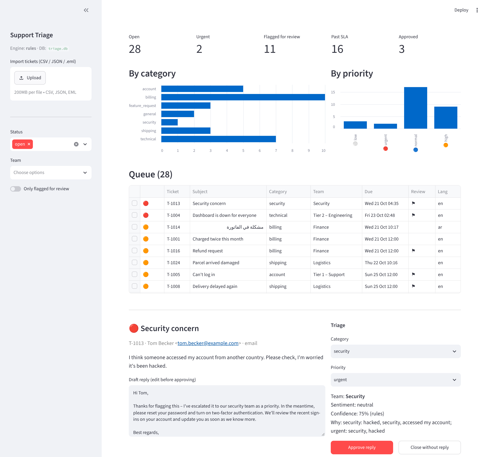

# Support Triage AI

Sorts incoming support tickets by category, priority and team, sets an SLA deadline, and drafts a reply for an agent to approve. It runs on keyword rules out of the box, and on OpenAI or Claude structured outputs when a key is set.



## What it does

```
email (.eml) ─┐
CSV / JSON   ─┼─► Ticket ─► classifier ─────────► team + SLA deadline ─► SQLite ─► review queue (Streamlit)
Zendesk hook ─┤             rules | OpenAI | Claude                                  edit draft → approve
POST /tickets ┘             (falls back to rules on any LLM error)
```

- **Classification:** category (billing, technical, account, security, shipping, feature request, general), priority, sentiment, language (English and Arabic) and a one-line summary.
- **Routing and SLA:** each category maps to a team. First-response deadlines are counted in business hours (Sun–Thu 08:00–17:00 Riyadh): urgent 1h on the clock, high 4h, normal 8h, low 24h.
- **Draft replies** that never promise refunds, dates or account changes. Agents edit and approve every draft in the queue; nothing is sent automatically.
- **Flagged for review** when confidence is low, the ticket is urgent, the customer is upset, or the LLM failed and rules were used.
- **Structured LLM output:** OpenAI uses the Responses API with a strict JSON schema; Claude uses a forced tool call with the same schema. Both are validated with Pydantic. A refusal, incomplete response, invalid category or HTTP error all fall back to the rules classifier instead of crashing the batch.
- **Intake:** CSV, JSON and `.eml` files (quoted replies are stripped), a generic `POST /tickets` webhook and a Zendesk webhook, all with optional token auth. Re-importing the same ticket is a no-op.

## Run it

```bash
pip install -r requirements.txt

# classify the 30 sample tickets (dates shifted so SLA timers look live)
python -m triage import data/sample_tickets.csv data/reply_example.eml --demo-dates

streamlit run app.py                  # review queue at http://localhost:8501
uvicorn triage.webhook:app --port 8001   # optional: real-time intake
```

To use an LLM instead of rules:

```bash
export TRIAGE_ENGINE=openai OPENAI_API_KEY=sk-...        # or
export TRIAGE_ENGINE=anthropic ANTHROPIC_API_KEY=...
```

## Tests

`pytest -q` runs 34 tests covering:

- the keyword rules, including Arabic and word-suffix edge cases (`accountant` ≠ `account`)
- business-hours SLA maths across evenings and weekends
- OpenAI and Anthropic response parsing, using mocked HTTP
- fallback on refusals, schema violations and 429s
- `.eml` and Zendesk parsing, store idempotency and webhook auth

## Layout

```
triage/
  models.py     Ticket + Triage schemas (shared by rules and LLM)
  rules.py      keyword classifier and reply templates
  llm.py        OpenAI Responses / Anthropic tool-use adapters
  pipeline.py   engine selection, fallback, team routing, SLA
  sources.py    CSV / JSON / .eml / Zendesk → Ticket
  store.py      SQLite persistence and review updates
  webhook.py    FastAPI intake
app.py          Streamlit review queue
data/           fictional sample tickets
```

## Notes

- The keyword rules are a baseline, not a model. They're tuned on the sample tickets and will miss phrasings they haven't seen. That's why low-confidence results are flagged for review and the LLM engine exists.
- For a live helpdesk, the next step would be posting approved replies back through the Zendesk or Freshdesk API, and using agent corrections as evaluation data.

---

Built by [Usman Saleem Bhatti](https://www.upwork.com/freelancers/~017ac7683856df4451). All tickets and customers in `data/` are made up.
