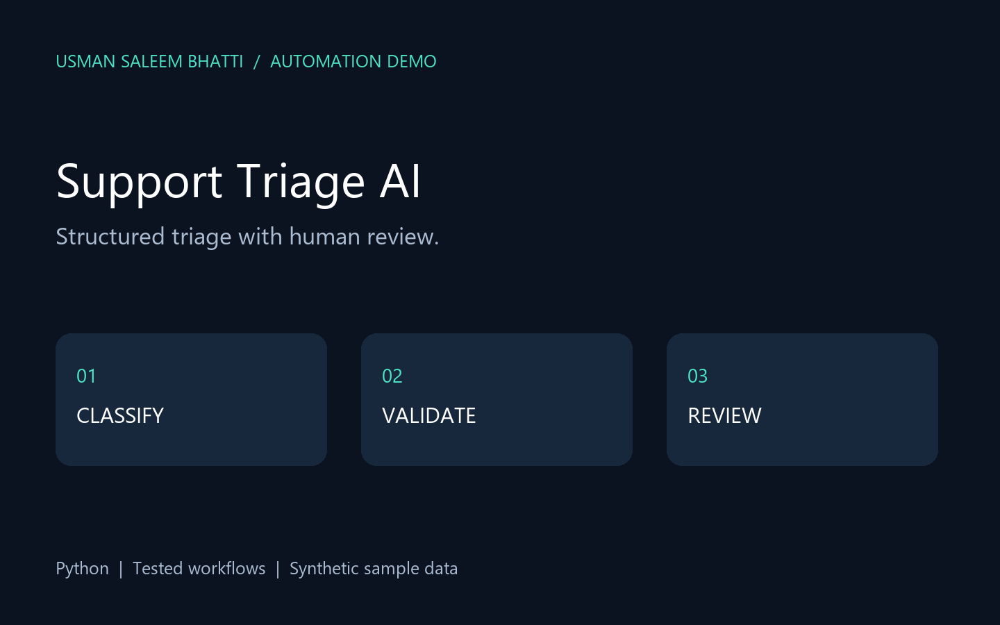

# Support Triage AI

AI integration adapter with schema validation and human review; offline demo included.



**Portfolio demonstration by Usman Saleem Bhatti.** Newly built with AI assistance and synthetic sample data; not represented as past client work.

## Workflow

`Ticket JSON → provider adapter → validated classification → human review → report`

## Features

Offline rules mode, optional OpenAI Responses API integration, structured JSON output, schema checks, refusal handling, duplicate-ticket detection.

## Quick start

Python 3.11 or newer. No third-party dependencies.

```sh
python app.py --demo --output runs
python -m unittest discover -v
```

Open `runs/report.html` in a browser. `runs/result.json` contains structured output. Demo reruns reuse their local ledger where applicable; use a fresh output folder to repeat the first-run scenario.

## Custom input

```sh
python app.py --input sample.json --output runs
```

## What is tested

The unit tests cover the business rules, malformed inputs and important failure paths. The generated `demo-report.html` is a checked-in sample report for quick inspection. Runtime output and databases are ignored by Git.

## Daily checks

The included `checks.yml` is a GitHub Actions workflow template. To activate it, place it at `.github/workflows/checks.yml`. It runs tests and the demo daily and on pushes, retaining run logs and a report artifact. The local portfolio bundle also includes `run_daily_checks.py` for background checks.

## Scope and limitations

Offline mode uses rules, not AI. Live mode is implemented but not live-tested without credentials. Every draft remains for human review; no messages are sent.

## Optional live AI mode

Set `OPENAI_API_KEY` and `OPENAI_MODEL` in your environment, then run `python app.py --live --input sample.json --output runs`. This explicitly sends ticket text to OpenAI and may incur API charges. `.env.example` is a reference, not an automatically loaded secrets file. Keep credentials server-side. No live request was made during demo validation.

API reference: https://developers.openai.com/api/docs/guides/structured-outputs

## Contact

[Usman on Upwork](https://www.upwork.com/freelancers/~017ac7683856df4451) · [GitHub](https://github.com/Usb01)
